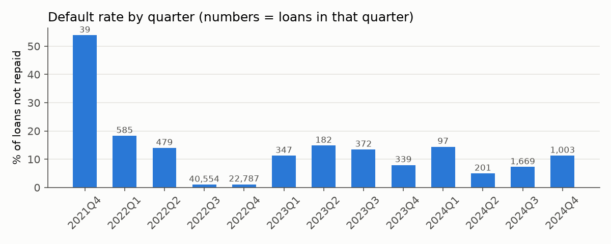
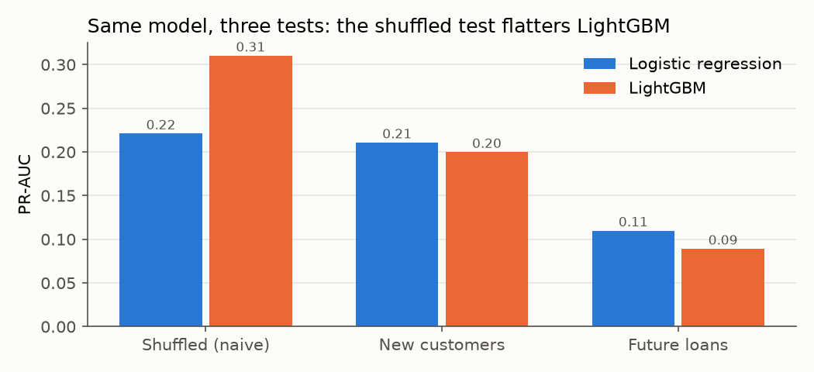
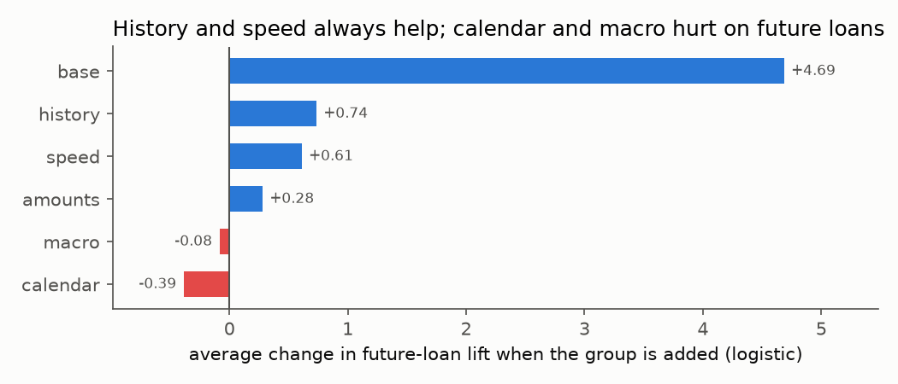

# 05 · Features and fair tests (Joseph)

Code: [`src/features.py`](../src/features.py) (the clues) and [`notebooks/01_eda.ipynb`](../notebooks/01_eda.ipynb) (every experiment; runs in about 6 minutes). You don't need to run anything: every result is pasted below. Decision records: [ADR 0012](../docs/adr/0012-final-feature-set.md), [ADR 0014](../docs/adr/0014-time-test-known-outcomes.md).

> **Updated 26 Oct:** Germain's step 6 work showed the future-loans test was learning from older loans whose outcome wasn't known yet ([ADR 0014](../docs/adr/0014-time-test-known-outcomes.md)). That's fixed, and every number below comes from the corrected test. No decision changed; the case for logistic regression got stronger.
>
> **Also 26 Oct ([ADR 0015](../docs/adr/0015-history-fixes-from-review.md)):** after Germain's review, `last_amount` became the average of the borrower's most recent earlier day, history now also counts the 190 not-yet-due loans, a **first-ever-loan** score was added, and a grace-period test was run. Numbers below are from that version.

## What the others need to know

1. **Use `FEATURES` for both tasks.** That's 13 clues: Liza's 3 base columns + borrower history + borrowing speed + past loan amounts. **No calendar, no macro.**
   ```python
   import sys; sys.path.insert(0, "../src")
   from features import build, splits, FEATURES
   train, test = build("../data/zindi")
   ```
2. **Test on future loans first** (`splits(train, "time_block")`), then on new customers (`"fold_customer"`). **Never trust the shuffled test:** it made LightGBM look 50% better than it is (0.31 vs 0.20).
3. **A borrower's history is the best new clue.** A customer's first loan defaults 6.1% of the time, later loans 1.1%.
4. **Past loan amounts are the key clue for Task 1 (Alice).** The typical error drops from about 2.5× to about 1.8×.
5. **Calendar and macro looked useful but were fake helpers.** They only helped when old and new loans were mixed; on future loans they made things worse.
6. **Logistic regression is clearly better than LightGBM on future loans** (lift 8.0 vs 5.6, and the bootstrap difference is entirely below zero).
7. **Scores are noisy.** The same model can move ±0.02–0.03 in PR-AUC just from how customers are randomly split. Only trust gaps bigger than that, or check with a bootstrap.
8. **Ghana warning (Alice, Liza):** no Ghanaian applicant has any history, so history, speed and amounts are all empty for them. On Kenyan **first-ever loans** (no history at all), the model is only about **2.7×** better than random, against 8× overall. Expect it to be much weaker in Ghana.
9. **Selection bias, for the report:** only 12% of people who defaulted ever got another loan. The lender cuts them off, so our data mostly contains people it kept lending to.

## Words used in this file

- **Clue (feature):** a piece of information the model uses to guess.
- **Borrower history:** what we knew about a borrower's earlier loans *on the day* of the new loan.
- **Leak:** a clue that secretly uses information from the future, so the model looks better in testing than it will be in real life.
- **Test (validation):** hide some loans, let the model learn from the rest, check its guesses on the hidden ones.
- **PR-AUC:** a 0-to-1 score for how well the model finds the rare defaulters. Random guessing scores about 0.018.
- **Lift:** PR-AUC ÷ the share of defaulters in the test loans, i.e. *how many times better than random*. We use it when comparing periods with different default rates.
- **Logistic regression:** a simple model that adds up a score from each clue. **LightGBM:** a powerful model made of many small decision trees.
- **Bootstrap:** re-pick the test loans at random, with repeats, hundreds of times and recompute the score each time. The spread shows how much is luck.

## The question

Liza's audit left us four safe columns. They're thin. Step 5 had to answer three questions:
1. **What extra clues can we build safely?**
2. **How do we test the model so the score is honest?**
3. **Which clues should the final model actually use?**

## What I did

1. **Looked at loan histories** (5.1).
2. **Built borrower history** in `src/features.py`, counting only what was known on the day (5.2).
3. **Built calendar and macro clues** (5.3).
4. **Built three kinds of test**, plus a fourth for "new people, later time" (5.4).
5. **Added two more clue groups:** borrowing speed and past amounts (5.4b).
6. **Tried every option:** every combination of clue groups, every column removed, every variant, two models, with a noise check (5.5).
7. **Checked Task 1**, since both tasks share the clues.

## What I tried and what happened

### Step 5.1: What history looks like

Imagine a borrower, **Ama**. She takes loans on 1, 5 and 10 March, each for 7 days.
- On **10 March**, NkwaPay knows she had 2 earlier loans.
- It also knows how the **1 March** loan ended, because it was due on 8 March.
- It does **not** know how the **5 March** loan ended: that one isn't due until 12 March.
- "Time-safe history" means we only use what NkwaPay could know that day.

| Fact | Number | What it means |
|---|---|---|
| Rows vs loans | 68,654 rows, 66,520 loans | 2,134 loans are split between lenders, so count loans, not rows |
| A customer's first loan vs later loans | 6.1% vs 1.1% default | Experience is a strong clue |
| Defaulters who borrow again | 12% (vs 93% of repayers) | The lender cuts defaulters off (**selection bias**) |
| Loans with earlier loans but none finished yet | 7.4% | Their past default rate is *unknown*, not 0% |
| Loans sent the same day as another loan to the same person | 21% | Same-day loans can't see each other's outcome |
| Ghanaian test loans with any history | **0%** | The model sees all of Ghana as first-timers |

### Step 5.2: Building history safely

The clues for each loan:
- number of earlier loans;
- how many of them had finished;
- how many defaulted;
- the past default rate, left **empty** if nothing had finished, plus a yes/no "no known history" flag;
- days since the last loan.

**How I know it's right:**
- **The made-up Ama test:** run `python src/features.py`.
- **A real-data check:** for 2,000 random loans I recomputed everything with a slow, obvious loop. **0 differences.**

### Step 5.3: Calendar and macro

- **Calendar:** month, weekday, day of month.
- **Macro:** inflation, deposit interest rate, exchange rate and unemployment for the loan's country. These are the only 4 indicators that exist for both Kenya and Ghana.
- **Last year's figures:** each loan gets the *previous* year's macro numbers, because a year's figures are only published after the year ends.

Two warnings showed up straight away:
- **The training loans are all Kenyan and cover 4 years,** so each macro clue has just 4 possible values. It can only learn "which year".
- **Ghana's inflation (10–31%) is far outside Kenya's (5–8%).** The model has never seen numbers like that.

### Step 5.4: Three kinds of test



**Why this picture matters:** 92% of loans are from Jul–Dec 2022, when about 1% defaulted. Every other period has 5–15%. So *when* a loan was made changes a lot, and a test that mixes old and new loans hides that.

| Test | How loans are hidden | Like... |
|---|---|---|
| **Shuffled** | at random | an exam that reuses students you already know |
| **New customers** | all of a customer's loans hidden together | an exam with only new students |
| **Future loans** | learn from older loans, test on newer ones | next year's class: real life |
| **Future loans, new customers** | newer loans from people never seen while learning | the closest Kenyan stand-in for Ghana |



| PR-AUC (all clues except macro) | Shuffled | New customers | Future loans |
|---|---|---|---|
| Logistic regression | 0.22 | 0.21 | **0.11** |
| LightGBM | **0.31** | 0.20 | 0.09 |

**What this means:**
- **The shuffled test flatters LightGBM by about 50%,** because it recognises customers it already saw. That's the brief's "how much the naive score was inflated".
- **On future loans** both models drop, and the simple one does better.

### Step 5.5: Every option

**What we tried:**
- every combination of 6 clue groups (63 combinations);
- every single column removed in turn;
- leaky vs safe history, and 4 look-back windows;
- two macro year rules;
- 2 models and 4 tests;
- extra random seeds.

That's about 1,700 model fits. Full results: [`tables/05_feature_comparison.csv`](tables/05_feature_comparison.csv).

| Group | Columns |
|---|---|
| base | `loan_type`, `duration`, `New_versus_Repeat` (Liza's audit) |
| history | earlier loans, finished, defaults, default rate, no-history flag, days since last loan |
| speed | loans taken in the last 7 and last 30 days |
| amounts | average and most recent earlier loan amount (never today's amount) |
| calendar | month, weekday, day of month |
| macro | inflation, deposit rate, exchange rate, unemployment |

**What each group adds on future loans:** for every combination, we compared it with and without the group.



| Group | Change in lift (logistic) | Helped in | Change on new customers |
|---|---|---|---|
| base | **+4.69** | 31 of 31 | +0.114 |
| history | +0.74 | 24 of 31 | +0.005 |
| speed | +0.61 | 24 of 31 | +0.011 |
| amounts | +0.28 | 23 of 31 | +0.005 |
| calendar | **−0.39** | 3 of 31 | +0.018 (helps here!) |
| macro | **−0.09** | 14 of 31 | +0.009 |

**The key lesson.** Calendar and macro *help* on the new-customer test, which mixes all periods, but *hurt* on future loans. So they weren't learning anything real about borrowers. They were learning *which period a loan came from*, which won't carry forward.

**Other variants (logistic, all clues except macro):**

| Variant | Future lift | Lift for no-history borrowers |
|---|---|---|
| Safe history (chosen) | 7.54 | **3.58** |
| Leaky history (outcomes counted as soon as a loan is sent) | 7.85 | **2.90** |
| Only the last 3 loans | 7.62 | 3.51 |
| Only the last 5 loans | 7.60 | 3.57 |
| Only the last 90 days | 7.28 | 3.44 |

**What this means:**
- **The leak looks slightly better overall** (7.85 vs 7.54). That's what a leak does: it borrows from the future. Yet it makes things worse for borrowers with no history (2.90 vs 3.58), the very people who look like Ghanaians. We use the safe version.
- **Look-back windows are within noise of using all past loans** (7.28–7.62 vs 7.54), so we keep it simple.

**Two checks added after Germain's review** ([ADR 0015](../docs/adr/0015-history-fixes-from-review.md)), for `FEATURES`:

| Check | Logistic | LightGBM | What it means |
|---|---|---|---|
| **First-ever loans** (no history at all; the true stand-in for Ghana): future lift | **2.70** | 1.98 | Much weaker than the 8× overall. The model mostly works by knowing a borrower's past. |
| **Grace period** (outcome known 0 / 7 / 30 days after the due date): future lift | 7.97 / 8.22 / 8.34 | 5.63 / 6.13 / 5.73 | All within the noise, so the due-date assumption doesn't change any conclusion. We keep 0 days. |

**Most important single columns:** removing `duration` or `loan_type` costs the most for both models. For LightGBM, `last_amount` comes next.

### Is the winner real? (bootstrap on future loans)

| Option (logistic unless marked) | Future lift | 95% range | Difference vs `FEATURES` (95% range) |
|---|---|---|---|
| base + history + speed | 8.15 | 6.55–10.33 | −0.06 to +0.49 (no real difference) |
| **`FEATURES` = base + history + speed + amounts** | **7.97** | 6.51–10.07 | — |
| all clues except macro | 7.54 | 6.09–9.68 | −1.04 to +0.05 (no real difference) |
| Liza's set (base + calendar) | 6.35 | 4.85–8.63 | **−2.36 to −0.97 (clearly worse)** |
| LightGBM, all clues except macro | 5.74 | 4.80–7.76 | **−3.52 to −0.70 (clearly worse)** |
| LightGBM, `FEATURES` | 5.63 | 4.70–7.20 | **−3.51 to −1.18 (clearly worse)** |

### Task 1: does it help predict the loan amount?

The error is measured on the log of the amount; lower is better. An error of 0.58 means a typical guess is off by about 1.8×; 0.91 means about 2.5×.

| Clues | Model | New customers | Future loans |
|---|---|---|---|
| guess the average | — | 0.978 | 0.972 |
| Liza's set | linear | 0.912 | 0.924 |
| base + history + speed | linear | 0.910 | 0.921 |
| **`FEATURES` (+ past amounts)** | linear | **0.597** | **0.632** |
| **`FEATURES` (+ past amounts)** | LightGBM | **0.579** | **0.581** |
| all clues except macro | linear | 0.596 | **0.782** (calendar breaks it on future loans) |

## Decision

**`FEATURES` = base + history + speed + amounts** (13 clues), for both tasks:
- safe history over all past loans;
- **no calendar and no macro.**

## Why

1. **History and speed help on future loans every single time.**
2. **Past amounts transform Task 1** (error 0.91 → 0.58), and they cost Task 2 nothing measurable (8.15 vs 7.97, inside the noise).
3. **Calendar and macro only look good on tests that mix time periods,** and real use is always in the future.
4. **Simple choices won everywhere:** safe history over leaky, all loans over windows, and logistic regression beats LightGBM on future loans.

## What I'm unsure of / limits

- **Selection bias:** we only see borrowers the lender kept lending to. People it refused or cut off are mostly missing, so the model learns from a filtered group.
- **The future-loans test leans on the last time block:** Nov 2022 – Nov 2024, which defaults about 4% of the time. More years of data would make it steadier.
- **Ghana:** none of the history clues exist for Ghanaian applicants, and their loan types and lenders are mostly unseen. Nothing here proves the model works in Ghana. That's Alice's and Liza's steps.
- **Amounts are in local currency.** For Kenyan training this doesn't matter, but any Ghana comparison must convert to USD.
- **Calendar or macro might help with many more years of data.** With 4 years, they can't.

## Likely Q&A questions and answers

**Q: How do you know your history clues don't use the future?**
A: Past outcomes only count after their due date, and same-day loans are excluded. We checked it on a made-up borrower and against a slow loop on 2,000 real loans: zero differences.

**Q: How much did the naive (shuffled) test inflate the score?**
A: For LightGBM, from 0.20 on new customers to 0.31 shuffled: about 50%. Logistic regression barely moved (0.21 → 0.22).

**Q: Why did you drop the calendar and macro clues the brief asked you to build?**
A: We built and tested them. They helped only when old and new loans were mixed, and on future loans they didn't help in most combinations (calendar in 28 of 31, macro in 17 of 31), lowering lift on average. With only 4 years of Kenyan data, macro just stands in for the year.

**Q: Why use past amounts if they barely help the default model?**
A: Both tasks must share the same clues, and past amounts cut the loan-amount error from 0.91 to 0.58. Their cost to the default model is inside the noise.

**Q: Isn't LightGBM better? It's what usually wins.**
A: On the shuffled test it looks better, but that's because it recognises customers. On future loans, logistic regression is clearly better (lift 8.0 vs 5.6), and it's easier to explain to borrowers and the regulator.

**Q: What does this mean for Ghana?**
A: Ghanaian applicants have no history, so the model only has the base clues for them. On Kenyan first-ever loans it's about 2.7× better than random, against 8× overall. We expect it to be much weaker in Ghana, and we say so.
