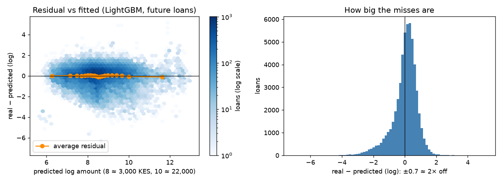

# 09 · Task 1: the loan-amount model (Alice)

## What the others need to know
- **We predict the log of the loan amount, not the amount.** Amounts run from 2 to 23,000,000 shillings. On the log scale, "10× bigger" is the same step at any size, so a few giant loans can't take over.
- **LightGBM wins.** On future loans its typical guess is off by about **1.8×** (log error 0.581), and **70%** of guesses are within 2× of the real amount. Ridge is off by 1.9× (0.630, 64%). Guessing the average is off by 2.6× (0.972, 44%).
- **The win is real, not luck.** The bootstrap difference vs Ridge is −0.049, with a 95% range of −0.054 to −0.045, far from 0.
- **The past loan amounts do most of the work.** Without them, the error is 0.92 (step 5). The model basically learns "about the size of your recent loans, adjusted for the loan type".
- **The limit = the amount 75% of similar recent borrowers got at most.** It beats the rule of thumb "same as your last loan" on every measure:
  - 74% of borrowers fit under it (vs 53%);
  - 70% of the money still gets lent (vs 66%);
  - only 5.9% of the money lent goes to loans that later default (vs 7.5%).
- **Any limit cuts losses a lot.** With no limit, 15% of the money goes to loans that default, even though only 1.8% of loans default. Defaulters take bigger loans.
- **For reserves, use the "average", not the "typical" amount.** The typical amounts add up to only 69% of the real total. The smearing fix brings that to 98%.
- **Watch-out for fairness (Liza):** the model over-predicts **first loans** by about 1.4×. Those borrowers would get relatively generous limits.

## The question
For each applicant, how much should NkwaPay lend? The amount sets the **limit** (the most it will lend) and helps plan **reserves** (how much cash to keep ready). The brief calls this Task 1, a regression: predicting a number instead of a yes/no.

## What I did
Code: [`notebooks/03_regression.ipynb`](../notebooks/03_regression.ipynb). The final recipe is in [`src/amounts.py`](../src/amounts.py), so the scorer uses exactly the same thing.

1. Used the shared 13 clues (`FEATURES`). The target is `Total_Amount`, never a clue.
2. Learned the **log** of the amount. Skewness, a measure of lopsidedness where 0 is balanced, drops from 104 to 0.13.
3. Tried a few settings for each model on the "new customers" test, then compared the best version of each model on all four tests.
4. Tested the diverging paths:
   - raw vs log target;
   - two ways back to shillings;
   - shillings vs dollars;
   - a bootstrap for every close call.
5. Checked the residuals (the misses) by size and by group.
6. Turned the prediction into a limit, testing five limit rules.
7. Fitted the final model on all loans and saved it locally (not in git).

**Words used:**
- **MAE (log):** the average size of the miss on the log scale. 0.58 means a typical guess is e^0.58 ≈ 1.8 times too high or too low.
- **RMSE:** like MAE, but big misses count more, because they are squared first.
- **Within 2×:** the share of guesses between half and double the real amount.
- **Residual:** real minus predicted.
- **Bootstrap:** re-draw the test customers 1,000 times to see how much a difference wobbles. If the middle 95% of the wobbles doesn't cross 0, the difference is real.

## What I tried and what happened

**Models, future-loans test** (the main test):

| Model | MAE log | RMSE log | Median miss (KES) | Within 2× |
|---|---|---|---|---|
| Guess the average | 0.972 | 1.262 | 3,642 | 44% |
| OLS (linear regression) | 0.630 | 0.822 | 2,269 | 64% |
| Ridge (alpha 0.1) | 0.630 | 0.823 | 2,269 | 64% |
| Lasso (alpha 0.0001) | 0.628 | 0.820 | 2,262 | 65% |
| k-NN (k = 100) | 0.603 | 0.818 | 2,117 | 68% |
| Decision tree (depth 8) | 0.595 | 0.810 | 2,146 | 69% |
| SVR (C = 3, 5,000-loan sample) | 0.592 | 0.860 | 2,130 | 71% |
| Random forest (leaf 5) | 0.583 | 0.795 | 2,110 | 70% |
| **LightGBM (300 trees, 31 leaves)** | **0.581** | **0.796** | **2,087** | **70%** |

**Across tests (MAE log):** for LightGBM, shuffled 0.576 → new customers 0.579 → future loans 0.581 → future loans from new customers 0.593. The naive shuffled test flatters by only about 0.005. Unlike the default model, knowing the customer barely helps. Future new customers, the closest Kenyan stand-in for Ghana, are a little harder.

**Bootstrap** (future loans; negative = the first model misses less):

| Comparison | Difference | 95% range | Verdict |
|---|---|---|---|
| LightGBM − Ridge | −0.049 | −0.054 to −0.045 | LightGBM better |
| LightGBM − SVR | −0.012 | −0.017 to −0.007 | LightGBM better |
| Random forest − LightGBM | +0.002 | +0.0004 to +0.003 | LightGBM better, by a hair |
| Lasso − Ridge | −0.003 | −0.003 to −0.002 | tiny but real |

**Other paths:**

| Option | Result | Verdict |
|---|---|---|
| Learn raw shillings (LightGBM / Ridge) | MAE log 0.639 / 2.19 | worse: giant loans take over |
| Back to shillings with e^pred (the typical amount) | totals add up to 69% of the real money | right for one borrower's limit |
| e^pred × smearing (the average amount, factor ≈ 1.4) | totals add up to 98% | right for reserves |
| Dollars instead of shillings (in Kenya) | 0.586 vs 0.581 | no gain; matters for Ghana (step 10) |

**Residuals** ([figure](figures/09_residuals.png)):
- The average residual is −0.001, so there's no overall bias.
- The spread grows a little with size (0.73 → 0.88).
- **By group:**
  - first loans are over-predicted (−0.36);
  - Type_10 is over-predicted (−0.50) and Type_9 under-predicted (+0.34);
  - loans that later defaulted were about 16% bigger than predicted (+0.15). Borrowing above your usual size is a mild warning sign.

**Limit rules** (future loans):

| Rule | Fits under limit | Money lent | Defaulted money | Default rate: over the limit / within |
|---|---|---|---|---|
| No limit | 100% | 100% | 15.2% | — / 1.8% |
| Last loan amount | 53% | 66% | 7.5% | 2.3% / 1.4% |
| Model, 25% | 22% | 39% | 5.9% | 1.9% / 1.4% |
| Model, 50% | 48% | 58% | 5.8% | 1.9% / 1.7% |
| **Model, 75%** | **74%** | **70%** | **5.9%** | 2.2% / 1.7% |

In plain English: the 75% limit lets three in four borrowers take what they wanted. It still cuts the money lost to defaulters from 15% to 6%. The "last loan" rule cuts less risk and blocks more people.

## Decision
LightGBM on the log amount, in local currency. Limit = e^(prediction + q75). Reserves use the smearing-corrected average. Ridge is the readable fallback. See [ADR 0018](../docs/adr/0018-loan-amount-model.md).

On the Zindi test's Kenyan loans, which the model never saw, the final model misses by 0.573 on the log scale, 71% of guesses are within 2×, and 70.5% of borrowers fit under the 75% limit (74% in testing).

## What I'm unsure of / limits
- **Limit, not affordability.** We have no income data. The BoG directive wants an affordability check, which this can't do.
- **The "real" amount is what NkwaPay lent, not what the borrower needed.** The model copies past lending habits, good or bad.
- **SVR** was learned on a 5,000-loan sample, so it may be a little under-rated.
- **The reserves factor depends on the period.** The 98% total used a smearing factor of about 1.4, measured inside each test. The saved model measures it on the newest 20% of loans and gets 1.235, which would give about 85%. Reserves should be re-checked often.
- **Settings** were picked on the "new customers" test. Picking them on future loans might shuffle the close ones (random forest vs LightGBM), but not the big picture.
- **Money numbers** (defaulted-money shares) are driven partly by a few very big loans.

## Likely Q&A questions and answers
**Q: Why log the amount?**
A: Amounts are extremely lopsided: skewness 104, and 46 loans carry 15% of the money. On the log scale, misses are about *ratios* ("2× too high"), which is what matters for a limit. Learning raw amounts made LightGBM worse (0.64 vs 0.58), and Ridge far worse.

**Q: The committee prefers simple models. Why not Ridge?**
A: For Task 2 we did pick the simple model. Here LightGBM is clearly more accurate, about 5% less miss per guess, with a bootstrap range far from 0. The amount model doesn't decide who gets a loan or give reasons, so readability matters less. Ridge stays as a fallback.

**Q: How does a predicted amount become a limit?**
A: The model predicts the typical amount for someone like you. We then raise it to the level that 75% of similar recent borrowers stayed under. That offset is measured on recent loans the model didn't learn from. The default model decides approve or decline first; the limit only applies if approved.

**Q: Why is RMSE in shillings so big (about 100,000 KES)?**
A: RMSE squares the misses, so a handful of multi-million loans dominate it. That's why we judge on the log scale and also report the median miss (about 2,100 KES).

**Q: How do you know the model isn't cheating?**
A: The amount is never a clue. Past amounts only use loans sent *before* the day. The main test learns only from older loans.
