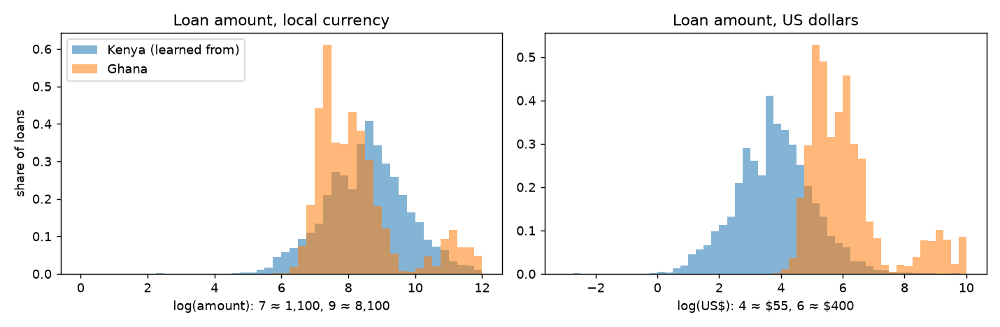

# 10 · Kenya → Ghana transfer (Alice)

> **Update, 6 Nov (Joseph):** this file says Ghana's outcomes can't be known. Zindi's scores turned out to reveal default rates by group: about 13% overall, and about 50% for Type_2. Some conclusions below change, especially "Type_2's risk comes from just 74 loans" and dropping `loan_type`. See [learnings/11](11_fairness.md) §10.

## What the others need to know
- **Ghana is not "Kenya in another currency".** A model that guesses "Ghana or Kenya?" from the clues gets it right almost every time (ROC-AUC **1.00**). The same model can't tell Kenya's training loans from Kenya's test loans (0.50), which shows the test works.
- **What gives Ghana away:**
  - **87%** of Ghanaian loans use a loan type Kenya never had (Type_3);
  - **97%** come from lenders Kenya never had;
  - **no** Ghanaian has a known repayment;
  - loans are **8× bigger in dollars** ($349 vs $44);
  - **14%** run over 90 days (Kenya 0.2%).
- **Re-weighting Kenya to look like Ghana doesn't work.** So few Kenyan loans look Ghanaian that the weighted data is worth about **19 loans** out of 68,464. Every weighted model got worse.
- **The default model, used as it is, would decline 47% of Ghanaian applicants** (Kenya: 19%). That includes **every first-time borrower** and **every Type_2 loan**. Type_2's "risk" comes from just 74 Kenyan loans.
- **The amount model works on real Ghanaian amounts** if we feed cedis in as they are. Its error is 0.45 on the log scale, better than in Kenya. But it over-predicts first loans (3.4×), loans over 90 days (3.1×) and Type_2 (2.8×).
- **Dollars don't help.** For amounts, converting to US$ was worse (0.51 vs 0.45).
- **What NkwaPay needs before trusting the default model in Ghana:** about **5,000 Ghanaian loans with known outcomes** (about 90 defaults). With fewer, an accuracy check is too noisy to mean anything.

## The question
NkwaPay has years of labelled Kenyan loans and none in Ghana. The brief (Part C) asks us to:
- compare the two countries;
- use a domain classifier or importance weighting to study the shift;
- say what evidence NkwaPay needs before trusting the model in Ghana.

**What we can and can't check:**
- **Default model:** Ghana has no labels, so we can't score it there directly.
- **Amount model:** `Test.csv` has the real amount of every Ghanaian loan, so we **can** check it on Ghana.

## What I did
Code: [`notebooks/04_transfer_and_fairness.ipynb`](../notebooks/04_transfer_and_fairness.ipynb), Part 1.
1. **Compared** three groups: Kenyan training loans, Kenyan test loans (a control) and Ghanaian test loans, on every clue.
2. **Scored the drift** of each clue with the PSI.
3. **Trained a domain classifier** with 12 different clue sets.
4. **Built importance weights** from it and measured how much data they leave (ESS), at six clipping levels.
5. **Scored the amount model on real Ghanaian amounts**, testing currency, `loan_type`, weights and naive rules.
6. **Scored Ghanaian applicants with the default model** under 8 options, and measured each option's cost on Kenya.
7. **Measured the closest Kenyan stand-ins** for Ghana's two kinds of applicant.
8. **Simulated how many labelled loans** a trustworthy Ghana check needs.

**Words used:**
- **Domain classifier:** a model trained only to tell Ghana from Kenya. If it can, the two groups look different.
- **ROC-AUC:** 0.5 = can't tell them apart, 1.0 = always can.
- **PSI (population stability index):** a drift score for one clue. Below 0.1 is stable, 0.1–0.25 some shift, above 0.25 a big shift.
- **Importance weight:** how much more a Kenyan loan should count because it looks Ghanaian.
- **ESS (effective sample size):** how many loans the weighted data is "really" worth.
- **Lift:** PR-AUC ÷ default rate, i.e. how many times better than random at finding defaulters.

## What I tried and what happened

### 1. How different is Ghana?

| | Kenya (learned from) | Kenya (test) | Ghana |
|---|---|---|---|
| Loans / customers | 68,464 / 6,508 | 15,069 / 4,516 | 3,525 / 446 |
| Customer also in Kenya's data | — | 98% | **0%** |
| Most common loan type | Type_1 (90%) | Type_1 (90%) | **Type_3 (86%)** |
| Loan type never seen in Kenya | 0% | 0% | **87%** |
| Lender never seen in Kenya | 0% | 0% | **97%** |
| Loans over 90 days | 0.2% | 0.2% | **14%** |
| First loan in the data | 9% | 9% | **19%** |
| At least one known earlier outcome | 83% | 83% | **0%** |
| Median amount, local currency | 5,249 KES | 5,149 KES | 3,002 GHS |
| Median amount, US$ | $44 | $43 | **$349** |

**Loan types in Ghana:**

| Type | Share of Ghana | Median US$ | Kenyan loans | Kenyan default rate |
|---|---|---|---|---|
| Type_3 | 86% | ~$300 | 0 | — |
| Type_2 | 13% | ~$9,300 | **74** | **61%** |
| Type_8 | 1% | ~$6,200 | 0 | — |

**Drift (PSI, Kenya → Ghana):** the full table is `tables/10_psi.csv`. Big shifts (PSI above 0.25) for: the loan type (17), the outcome clues (about 9: no Ghanaian has one), the borrowing counts and speed (0.9–3.2), the loan length (0.64) and the amounts. Only two clues are stable: the New/Repeat flag (0.01), and `n_defaults` (0.004), which is 0 for almost everyone in both countries. The money clues shift *less* in local currency than in dollars. Cedi amounts happen to look like shilling amounts; dollar amounts don't.

### 2. Domain classifier

| Clues used | Ghana vs Kenya (logistic / LightGBM) | Control: Kenya test vs Kenya |
|---|---|---|
| All 13 clues | 1.00 / 1.00 | 0.50 |
| Without `loan_type` | 0.99 / 0.99 | 0.50 |
| Without `loan_type` and outcome clues | 0.95 / 0.97 | 0.50 |
| `loan_type` only | 1.00 | 0.50 |
| Outcome clues only | 0.91 | 0.51 |
| Money clues only, local currency / US$ | 0.72 / 0.89 (logistic) | 0.50 |
| Borrowing counts and speed only | 0.85 / 0.86 | 0.50 |
| Loan length only | 0.54 / 0.59 | 0.50 |

In plain English: the loan type alone is enough to spot a Ghanaian loan. Even after removing the type and the outcome clues, the two groups are still easy to tell apart.

### 3. Importance weights

| Clipping | ESS (loans) | ESS share of Kenya | Weight held by the top 1% of loans |
|---|---|---|---|
| No cap | 19 | 0.03% | 99% |
| 99.9th percentile | 250 | 0.4% | 95% |
| 99th percentile | 1,934 | 2.8% | 53% |
| Cap at 50 | 343 | 0.5% | 93% |
| Cap at 10 | 708 | 1.0% | 85% |
| Cap at 5 | 974 | 1.4% | 78% |

(Clues: without `loan_type` and outcome clues, money in US$.)

The "Kenya made to look like Ghana" rests on a few hundred loans at best. 

### 4. Amount model on real Ghanaian amounts

| Option | MAE log | Within 2× | Bias (predicted ÷ real) |
|---|---|---|---|
| Guess Kenya's average (local / US$) | 1.09 / 2.38 | 39% / 1% | 1.76 / 0.13 |
| Same as last loan (a slight cheat for first loans) | 0.52 | 84% | 0.99 |
| **Model, as is (cedis fed in as shillings)** | **0.45** | **80%** | 1.23 |
| Model, US$ | 0.51 | 76% | 0.82 |
| Model, as is, no `loan_type` | 0.51 | 79% | 0.99 |
| Model, US$, no `loan_type` | 0.63 | 71% | 0.63 |
| Model, US$, no `loan_type`, weighted | 0.72–0.75 | 58–62% | 0.55–0.57 |

**By group** (best option):

| Group | Loans | MAE log | Bias |
|---|---|---|---|
| Earlier loans | 2,863 | 0.26 | 1.15 |
| First loan | 662 | 1.29 | **3.39** |
| 7-day loans | 3,041 | 0.33 | 1.17 |
| Over 90 days | 479 | 1.23 | **3.13** |
| Type_3 | 3,039 | 0.33 | 1.17 |
| Type_2 | 449 | 1.04 | **2.82** |
| Type_8 | 37 | 3.47 | 42 |

Why "as is" beats dollars: the model mostly learns "about the size of your recent loans". In cedis, a Ghanaian's past loans sit in the same number range as Kenyan ones, so the learned pattern carries over. In dollars, Ghanaian loans land among Kenya's rare big loans, which behave differently.

### 5. Default model on Ghanaian applicants
Share declined at Ghana's 3.2% cut-off:

| Option | Kenya future-loan lift | Average predicted default | Declined | First loans | Earlier loans | Type_3 | Type_2 |
|---|---|---|---|---|---|---|---|
| As is (step 7 model) | 7.8 | 12.5% | **47%** | 100% | 35% | 39% | 100% |
| Money in US$ | 7.9 | 12.8% | 47% | 100% | 34% | 38% | 100% |
| Unseen types → Type_1 | 7.8 | 10.8% | 15% | 60% | 5% | 2% | 100% |
| **Drop `loan_type`** | **6.9** | 8.7% | **28%** | 100% | 12% | 17% | 100% |
| Drop `loan_type`, US$ | 6.8 | 8.5% | 24% | 100% | 7% | 12% | 100% |
| Drop `loan_type`, US$, weighted | 4.7–5.2 | 12–14% | 68–100% | 100% | 60–100% | 63–100% | 100% |
| *Kenya test, step 7 model, 2.1% cut-off* | — | 1.8% | 19% | | | | |

Why so many declines? No Ghanaian has a known outcome, so the model sees all of them as "history unknown". In Kenya, that group defaults 5–11%. Declining people because their data is missing, not because they are risky, is exactly the unfairness the brief warns about.

### 6. Kenyan stand-ins
These are the Kenyan loans most like Ghana's two kinds of applicant, scored on future loans.

| Kenyan loans | Loans | Defaults | Lift | 95% range |
|---|---|---|---|---|
| All future loans | 54,463 | 988 | 7.1 | 6.1–8.4 |
| First loans (like Ghana's 19%) | 2,514 | 275 | **2.5** | 2.1–3.0 |
| Earlier loans, no known outcome (like Ghana's 81%) | 1,436 | 69 | 6.5 | 4.5–10.4 |

(Step 5's figures, 2.7 / 9.0 / 7.6, averaged the four time blocks. Here the blocks are pooled, which weights them by size. Both fall inside these ranges.)

### 7. How many labelled Ghanaian loans are needed?

| Labelled loans | Defaults (about) | Lift 95% range |
|---|---|---|
| 1,000 | 18 | 3.2–21.5 |
| 2,000 | 36 | 4.5–15.2 |
| **5,000** | **90** | **4.9–10.9** |
| 10,000 | 182 | 5.7–9.1 |
| 20,000 | 364 | 6.1–8.5 |

## Decision
See [ADR 0019](../docs/adr/0019-kenya-to-ghana-transfer.md). In short:
1. No importance weighting.
2. The amount model is used in Ghana in local currency, for repeat borrowers on loans up to 90 days. Others get a policy starter limit.
3. The default model must not auto-decline in Ghana yet. For a pilot, score with the version **without `loan_type`**, and send first loans and Type_2 to small starter loans or manual review.
4. Trust it fully only after about 5,000 labelled Ghanaian loans, a Ghana recalibration, and monthly drift checks.

## What I'm unsure of / limits
- **Every Task 2 number for Ghana is a description, not an accuracy.** We can't know which option is *right* without outcomes.
- **The stand-ins assume** Ghanaians behave like similar Kenyans. Nothing shows that they do.
- **Ghana's test loans are mostly 2022.** Ghanaian inflation was 31–38% in 2022–23, so cedi amounts are on a moving scale.
- **Exchange rates are yearly averages,** which is rough when a currency falls fast (the cedi went from 5.8 to 11.0 per dollar).
- **Ghana's data is small:** 446 customers. The amount results for Type_8 (37 loans) are noise.

## Likely Q&A questions and answers
**Q: Can you just train on Kenya and use it in Ghana?**
A: For the loan amount, mostly yes. On real Ghanaian amounts it misses by about 1.3× for repeat borrowers (log error 0.26), but over-predicts first loans and long loans about 3×. For default, no, not yet. It would decline 47% of Ghanaians, versus 19% of Kenyans, largely because Ghanaian outcomes are missing.

**Q: Why didn't importance weighting help?**
A: Weighting can only re-balance people who exist in both countries. Almost no Kenyan loan looks Ghanaian: the domain classifier scores 0.95+ even without loan type. So the weights pile onto a few dozen loans (ESS 19), and the model learns from almost nothing.

**Q: Should amounts be converted to dollars?**
A: We tested it. For amounts on real Ghanaian data, local currency was better (0.45 vs 0.51). For the default model it barely matters (lift 6.9 vs 6.8). We keep local currency.

**Q: What would make you trust the model in Ghana?**
A: About 5,000 Ghanaian loans with known outcomes (around 90 defaults), so the lift is known to within about ±3. Platt recalibrated on them. Monthly PSI checks. Bureau data under the Credit Reporting Act would give outcomes faster.

**Q: Why drop `loan_type` for Ghana if it's the strongest clue in Kenya?**
A: In Ghana the model has never seen 87% of the types, and the other 13% (Type_2) rest on 74 Kenyan loans. Keeping it means guessing, and mapping Type_3 to Type_1 assumes it is as safe as Kenya's safest product, with no evidence. Dropping it costs 0.9 lift in Kenya, but makes no claim we can't back up.
