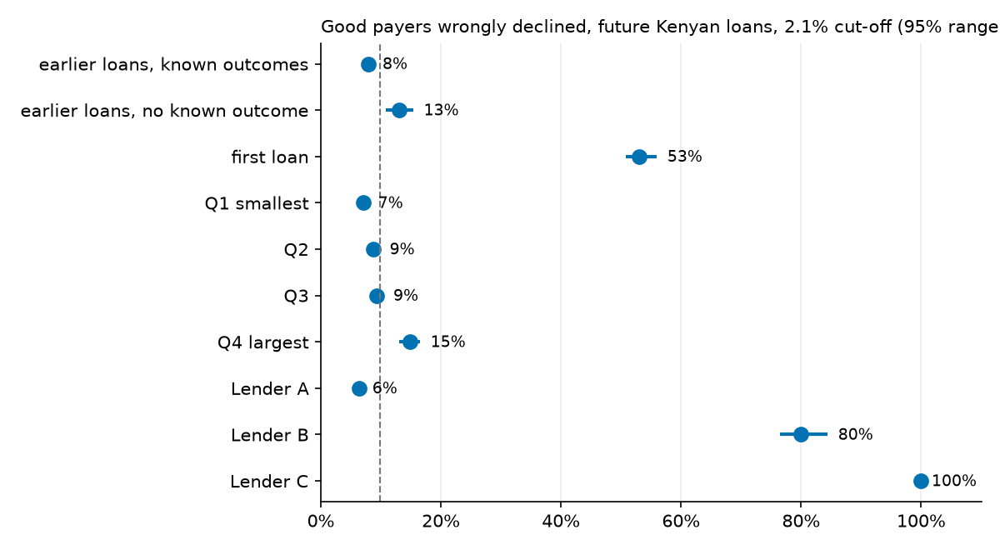
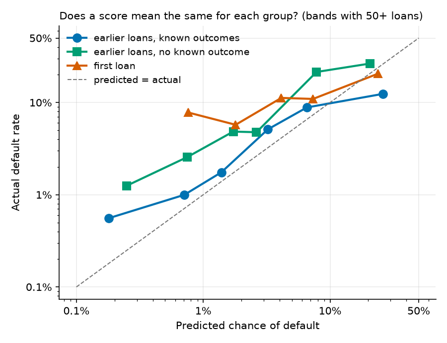

# 11 · Fairness, proxies and the fixes (Joseph, taking over from Liza)

## What the others need to know
- **The biggest unfairness is against first-time borrowers.** On future Kenyan loans, 53% of first-timers who would have repaid are turned away, against 8% of borrowers with a record.
- **On launch it's total.** Fitted on all our data, the model declines **every** first-time applicant, in Kenya and in Ghana. You can't build a record without a first loan.
- **The gap isn't a pricing mistake.** First loans really do default more (10.9% vs 1.3%). The scores are not too high for them; if anything, a little too low. So "fix the score" isn't the answer.
- **We changed two things:**
  1. Dropped the 3 "borrow often" clues. It costs nothing (−0.6 KES per loan, within noise) and removes the message "you haven't borrowed recently", which 31% of declined Kenyans were getting.
  2. First-timers above the cut-off get a **starter loan of about 10% of a typical loan** instead of a no. In Kenya, only below 24% predicted risk.
- **We tested 1,224 combinations of these choices (section 9).** Together they cost about **+1 KES per loan** on the narrow view, and save about **3 KES** at the repeat value we measured. It isn't free, and my first estimate of the saving (7.7) was about twice too high.
- **Deleting a column doesn't remove a group.** Hiding tenure made first-timers' approval *worse* (41% vs 45%), because other clues still give them away (AUC 1.00).
- **The model isn't regressive.** Small loans are approved more often than large ones (93% vs 84%).
- **The limit runs the other way:** it offers small borrowers 2.8× what they took. That's a debt risk (see limits).
- **Risk sits with products and lenders.** Lender A has 95% of loans and 71% of defaults. Lender B has 5% of loans, 22% of defaults and a 19% approval rate. `lender_id` isn't a clue, but `loan_type` gives it away (AUC 0.98).
- **We now have real evidence on Ghana, and it's bad news for our Ghana rules (section 10).** Ghana defaults about **13%**, seven times Kenya. Even Type_3, the common product, defaults about 7%, above the 3.2% break-even. Our proposed Ghana model is the costliest of the three we tested. **The Ghana rules are under review.**
- **We can't test gender.** The loan data has none. Findex shows women are behind men in Ghana on accounts (63% vs 74%).

## The question
The brief (Part D) asks:
- Does the model treat countries, products, lenders, new borrowers or small loans differently?
- Do those gaps matter, and what can we do?
- Does it meet Ghanaian law, and does it help or hurt access to credit?

## What I did
Code: [`notebooks/04_transfer_and_fairness.ipynb`](../notebooks/04_transfer_and_fairness.ipynb), Part 2. 10–20 minutes for the whole notebook, depending on the machine.

1. Counted loans and defaults per group, before any modelling.
2. Scored future Kenyan loans with step 7's recipe and measured every group at the 2.1% cut-off, with 95% ranges.
3. Tested whether the clues can guess each group (proxies).
4. Compared 11 fixes on cost and on fairness, then tested 1,224 combinations of the winners.
5. Applied the choices to Zindi's test applicants, the people the model has never seen.
6. Checked the loan limit, and read Findex.

The audit documents are separate: [Model Card](../docs/model_card.md), [datasheet](../docs/datasheet.md), [compliance map and borrower letter](../docs/compliance.md).

**Words used:**
- **Tenure:** how long you've been a borrower. Here: first loan, earlier loans with no known outcome, or earlier loans with known outcomes.
- **Wrongly declined:** among people who would have repaid, the share we turned away.
- **Defaulters caught:** among people who didn't repay, the share we turned away.
- **Calibrated:** predicted chances match what really happens.
- **Proxy:** a clue that gives away someone's group even if the group itself isn't in the model.
- **Thin file:** a borrower with little or no record.
- **Lift:** PR-AUC ÷ default rate; how many times better than random at finding defaulters.

## Three kinds of fair, and why we can't have them all
(`knowledge/fairness_reading.md` §4.)

| Name | In plain words | Our check |
|---|---|---|
| **Independence** | Everyone gets yes equally often | Approval rates |
| **Separation** | Mistakes fall equally | Wrongly declined; defaulters caught |
| **Sufficiency** | A score means the same risk for everyone | Predicted vs actual |

When groups really default at different rates, these can't all hold at once. It's maths, not a modelling failure. We put **sufficiency first**, because an honest score is what makes the cost cut-off valid. Then we act on **wrongly declined**, the harm a borrower feels. Approval rates are reported, but we don't force them equal: that would ignore a real 8× difference in default rates.

## What I tried and what happened

### 1. The data, before any model

| Group | Loans | Defaults | Default rate |
|---|---:|---:|---:|
| First loan | 6,363 | 429 | 6.7% |
| Earlier loans, no known outcome | 5,567 | 96 | 1.7% |
| Earlier loans, known outcomes | 56,534 | 733 | 1.3% |
| Flagged "New Loan" | 566 | 119 | 21.0% |
| Smallest quarter of loans | 17,119 | 219 | 1.3% |
| Largest quarter of loans | 17,116 | 516 | 3.0% |
| Type_1 | 61,723 | 520 | 0.8% |
| Type_7 | 2,654 | 235 | 8.9% |
| Lender A | 64,568 | 784 | 1.2% |
| Lender B | 3,454 | 316 | 9.1% |

### 2. How the model treats each group (future loans, 2.1% cut-off)

| Group | Loans | Defaults | Approved | Wrongly declined (95% range) | Defaulters caught | F1 | PR-AUC | Lift | Predicted / actual |
|---|---:|---:|---:|---|---:|---:|---:|---:|---|
| **All** | 54,463 | 988 | 89% | 10% (9–11) | 55% | 0.16 | 0.13 | 7.1 | 1.3% / 1.8% |
| Known outcomes | 50,513 | 644 | 92% | 8% (7–9) | 47% | 0.12 | 0.08 | 5.9 | 1.0% / 1.3% |
| No known outcome | 1,436 | 69 | 85% | 13% (11–15) | 61% | 0.29 | 0.31 | 6.4 | 2.4% / 4.8% |
| **First loan** | 2,514 | 275 | **45%** | **53% (51–56)** | 74% | 0.24 | 0.27 | **2.5** | 7.4% / 10.9% |
| Flagged "New Loan" | 387 | 48 | **0.3%** | 100% (99–100) | 100% | 0.22 | 0.27 | 2.2 | 10.5% / 12.4% |
| Smallest quarter | 13,866 | 190 | 93% | 7% (6–8) | 21% | 0.07 | 0.03 | 2.5 | 0.7% / 1.4% |
| Q2 | 14,182 | 224 | 90% | 9% (8–10) | 63% | 0.18 | 0.11 | 7.2 | 0.9% / 1.6% |
| Q3 | 13,374 | 182 | 90% | 9% (8–10) | 52% | 0.13 | 0.07 | 5.0 | 0.9% / 1.4% |
| Largest quarter | 13,041 | 392 | 84% | 15% (13–17) | 69% | 0.21 | 0.20 | 6.7 | 2.8% / 3.0% |
| Type_1 | 49,000 | 452 | 97% | 3% (3–3) | 11% | 0.06 | 0.02 | 2.6 | 0.5% / 0.9% |
| Type_7 | 2,654 | 235 | 25% | 74% (69–79) | 87% | 0.18 | 0.15 | 1.7 | 3.8% / 8.9% |
| Type_4 | 989 | 112 | 0.4% | 100% | 97% | 0.20 | 0.19 | 1.6 | 21.4% / 11.3% |
| Lender A | 51,654 | 699 | 93% | 6% (6–7) | 40% | 0.13 | 0.08 | 6.2 | 0.9% / 1.4% |
| Lender B | 2,563 | 215 | **19%** | **80% (77–84)** | 91% | 0.17 | 0.12 | 1.4 | 7.7% / 8.4% |
| Lender C | 246 | 74 | **0%** | 100% | 100% | 0.46 | 0.51 | 1.7 | 32.0% / 30.1% |

More in `tables/11_fairness_by_group.csv` (every type, 2022–24, ranges on five measures) and `tables/11_fairness_intersections.csv`.

**What the table says:**
- **First loans:** the gap is real and large (45 points, 95% range 43–48). The model also ranks them badly (lift 2.5 vs 5.9): it knows they're risky as a group but can't tell which ones.
- **Where groups overlap, it's sharper:** first loans in the largest quarter are 82% wrongly declined; first loans from Lender B are 99.8%.
- **The date matters as much as the group.** Approval falls from 95% in 2022 to 15–23% in 2023–24, because real default rates jumped. Step 7 found this too.
- **Small loans:** the model approves almost everyone and finds few defaulters (21%). Being lenient isn't the same as being accurate.

**Does the score mean the same thing?** Mostly yes at the top; at the bottom, first loans are riskier than scored. A first loan scored at about 0.8% actually defaulted 7.8% of the time.

So the score is not unfairly high for first-timers. The lesson: raising their approval by nudging scores would hide real risk. That's why the starter loan works on the *size* of the loan, not the score.

### 3. Proxies: can the clues guess the group?

| Group to guess | Clues used | AUC (logistic / LightGBM) |
|---|---|---:|
| Ghana vs Kenya | all 13 | 1.00 / 1.00 |
| | without `loan_type` | 0.99 / 0.99 |
| | without `loan_type` and outcome clues | 0.90 / 0.94 |
| First loan | all 13 | 1.00 / 1.00 |
| | loan details only (no history) | 0.61 / 0.62 |
| "New Loan" flag | everything but the flag | 0.97 / 0.97 |
| Lender A vs others | all 13 | 0.98 / 0.98 |
| | `loan_type` only | 0.98 |
| | without `loan_type` | 0.91 / 0.95 |
| Largest quarter of loans | all 13 | 0.92 / 0.93 |
| | without the two amount clues | 0.63 / 0.65 |

Not every proxy is bad: past loan sizes predict loan size because that's what they measure. The practical lessons:
- **Country and tenure can't be hidden.** Removing a column leaves them visible.
- **Lender is decided by product.** Even though `lender_id` isn't a clue, the model sorts by lender through `loan_type`.
- **Gender can't be tested.** See limits.

### 4. The fixes, compared
Same future loans, cost matrix from step 4. All settings are chosen on older loans only.

| Option | Lift | Cost (KES per loan) | Cost with repeat business | First loans: any loan | First-loan good payers refused | Other good payers refused |
|---|---:|---:|---:|---:|---:|---:|
| No fix | 7.78 | 47.9 | 86.7 | 45% | 53% | 8% |
| Starter loan, 10% | 7.78 | 50.1 | 80.2 | 100% | 0% | 8% |
| Own cut-off, equal wrongly declined | 7.78 | 52.3 | 87.7 | 65% | 33% | 8% |
| Own cut-off, equal approval | 7.78 | 52.7 | 87.3 | 70% | 28% | 8% |
| Drop "borrow often" clues | 7.72 | 47.3 | 85.2 | 47% | 51% | 8% |
| Hide tenure | 8.17 | 47.7 | 88.6 | 41% | 57% | 8% |
| Reweigh tenure and outcome | 7.14 | 52.0 | 100.3 | 68% | 30% | 12% |
| Drop `loan_type` | 6.89 | 51.8 | 106.4 | 35% | 63% | 12% |
| **Chosen: drop clues + starter 10%** | **7.72** | **49.5** | **79.0** | **100%** | **0%** | **8%** |

95% ranges on each cost change are in [ADR 0020](../docs/adr/0020-fairness-mitigation.md).

**Why the losers lost:**
- **Own cut-off:** it costs +4.3 KES, and it doesn't even reach equal, because a cut-off set on older loans misses on newer ones. It also still says no to a third of good payers.
- **Reweighing:** it wrecks honest scores: first loans get priced at 0.28× their real risk. It also refuses more good payers elsewhere (12% vs 8%).
- **Hide tenure:** approval for first loans falls. Lift goes up a little, but cost is unchanged within noise.

**How a starter loan is priced.** A typical bad loan costs 4,700 KES (4,500 lost + 200 chasing). At 10% size, a default costs 450 + 200 = **650 KES**, and a repaid one earns a tenth of the fee. Chasing doesn't shrink, so on the narrow view a starter loan loses money on its own: it only breaks even at 1.5% risk, and first loans run at about 11%. Counting a good customer's future business (step 4's 500 KES), it breaks even at about 39%. So the starter loan is a bet on repeat business. **That's the assumption to defend,** and section 9 tests it against what borrowers really did.

### 5. What people get told
Top reason among those declined. Sentences are from `src/reasons.py`.

| Top reason | Kenya, 13 clues | Kenya, no "borrow often" | Ghana, no `loan_type` | Ghana, no `loan_type` or "borrow often" |
|---|---:|---:|---:|---:|
| First loan with us | 44% | 47% | 30% | 38% |
| This kind of loan | 22% | 31% | 0% | 0% |
| No loans in the last 7 days | 13% | **0%** | 22% | **0%** |
| Only a few earlier loans | 12% | 12% | 0% | 0% |
| Long loan | 8% | 10% | 48% | 62% |
| **Told to borrow more, anywhere in their reasons** | **31%** | **0%** | **34%** | **0%** |
| Same top 3 after refitting | 90.5% | 85.4% | — | — |

"Only a few earlier loans" remains. It's about having too short a record, not about borrowing often right now, but it's worth watching.

**Correction to step 8.** I wrote there that "you haven't borrowed recently" was the most common reason. That was wrong: the *theme* "borrowing history" is the most common, but within it "first loan" leads, and "no recent loans" was the top reason for 13%. It appeared somewhere in 31% of reasons lists, so the concern stands.

### 6. On launch: applicants the model has never seen

| Policy | Full loan | Starter or review | Declined | First loans declined | Earlier loans declined |
|---|---:|---:|---:|---:|---:|
| Kenya, 13 clues | 81% | 0% | 19% | **100%** | 11% |
| **Kenya, chosen** | **82%** | **9%** | **9%** | **0%** | **10%** |
| Ghana, 13 clues | 53% | 0% | 47% | **100%** | 35% |
| Ghana, no `loan_type` + routing (ADR 0019) | 72% | 22% | 6% | 0% | 8% |
| **Ghana, chosen** | **78%** | **22%** | **0%** | **0%** | **0%** |

**Why did the country gap close?** The 47% vs 19% gap came mostly from unseen loan types, missing outcomes and first loans. It doesn't prove Ghanaians are as safe as Kenyans. We simply have no evidence either way.

**A regressive pattern we removed:** in Ghana, the no-`loan_type` model with routing declined 13% of the smallest loans and 1% of the largest. The clue drop removes it. In Kenya, the chosen policy declines 4% of the smallest and 16% of the largest.

### 7. Is the limit regressive?

| Group | Fits under limit | Limit ÷ real amount (median) | Median limit | Median real |
|---|---:|---:|---:|---:|
| Smallest quarter | 96% | **2.8×** | 3,443 | 1,299 |
| Q2 | 86% | 1.6× | 6,010 | 3,845 |
| Q3 | 65% | 1.2× | 8,700 | 7,488 |
| Largest quarter | 48% | 1.0× | 22,464 | 21,273 |
| First loan | 82% | **2.2×** | 8,284 | 4,480 |

So it's not regressive in the usual sense: small borrowers aren't short-changed. The opposite worry applies: it can offer someone nearly 3× what they normally take, which is a debt risk. First-timers should get the starter amount, not this limit.

### 8. Findex: who can't get credit in Ghana?
Survey-weighted shares of adults, 2021. 95% ranges in `tables/11_findex.csv`.

| Group | Share of adults | Any account | Mobile money | Own a phone | Borrowed from a bank or mobile money | Borrowed from family or friends |
|---|---:|---:|---:|---:|---:|---:|
| **All adults** | 100% | 68% | 60% | 85% | **7%** | 39% |
| Women | 51% | 63% | 55% | 81% | 6% | 37% |
| Men | 49% | 74% | 65% | 90% | 9% | 41% |
| Poorest 40% | 40% | 55% | 46% | 79% | 5% | 41% |
| Richest 60% | 60% | 77% | 69% | 89% | 9% | 37% |
| Age 15–24 | 30% | 65% | 62% | 84% | 5% | 38% |
| Age 25–44 | 42% | 73% | 67% | 89% | 8% | 41% |
| Age 45+ | 28% | 65% | 47% | 82% | 10% | 34% |
| Rural | 40% | 57% | 48% | 78% | 7% | 36% |
| Urban | 60% | 76% | 68% | 90% | 8% | 40% |
| Primary or less | 44% | 52% | 43% | 76% | 5% | 38% |
| Secondary or more | 56% | 81% | 73% | 92% | 9% | 39% |

**Does our model narrow or widen the gap?** About **93% of Ghanaian adults haven't borrowed from a bank or by mobile money**, so nearly anyone new to NkwaPay is a first-timer.
- **The model as it stood widens the gap.** It declines every first-time applicant, so it lends only to people who already have a record.
- **The chosen policy narrows it for people with a phone and a mobile-money account who ask for Type_3,** because they can now get a first small loan. Under [ADR 0021](../docs/adr/0021-ghana-rules.md), 55% of Ghanaian first-time applicants are still refused, because they ask for Type_2 or another unseen type.
- **It can't reach the rest.** 40% of adults have no mobile-money account, and they are more often women, rural, poorer and less schooled. A mobile-money lender can't see them, however fair the model.
- **This is population context, not a test of our model.** We can't link Findex to loans.

### 9. Testing every scenario
Section 4 changed one thing at a time and leaned on a guess. So I ran every combination: all ways of dropping the 3 clues × 17 starter policies × 3 cut-offs × 3 validation tests, **1,224 scenarios** (`src/fairness_scenarios.py`, `tables/11b_*.csv`, about 3 minutes). I wrote the pass rules first:
1. No cost rise beyond noise.
2. Fewer good first-timers refused, and no harm to others.
3. Consistent across tests.
4. Survives pessimistic assumptions.

**What is a returning customer really worth?** Step 4 guessed 400 KES. Our data can check this: follow Kenyan first-timers who repaid, and add up fees (2%) minus losses on their later loans.

| First-loan size (KES) | Repaid first-timers | Came back | Later loans | Net future value, mean (95% range) | Median |
|---:|---:|---:|---:|---:|---:|
| Up to 500 | 159 | 84% | 7.6 | 228 (−21 to 489) | 59 |
| 500–1,000 | 372 | 78% | 8.1 | 217 (18 to 382) | 66 |
| 1,000–2,500 | 1,218 | 79% | 7.7 | 174 (20 to 310) | 108 |
| 2,500–5,000 | 1,017 | 83% | 9.7 | −132 (−431 to 147) | 416 |
| 5,000–10,000 | 1,070 | 87% | 11.7 | 407 (−107 to 838) | 871 |
| Over 10,000 | 1,450 | 85% | 11.5 | **−10,500** (−19,585 to −3,531) | 2,049 |
| **All** | 5,286 | 83% | 10.0 | **−2,761** (−5,287 to −962) | 387 |

So for small starters, about **200 KES**, half the guess. And most customers are *typically* profitable while the *average* is negative, because a few big later loans lose a lot. Good news: small starters came back just as often, and small first loans defaulted less (4.1% at 500–1,000 KES vs 8.4% over 10,000), although borrowers chose those sizes themselves.

**The candidates** (cost change vs no fix, KES per loan, 95% range):

| Candidate | Test | Main costs | At the measured value |
|---|---|---:|---:|
| Drop clues only | future loans | −0.6 (−2.0 to 0.8) | −1.1 (−2.5 to 0.3) |
| | future loans, new customers | −2.6 (−9.4 to 3.8) | +2.1 (−5.6 to 9.3) |
| | new customers | −0.3 (−1.0 to 0.3) | −2.3 (−3.0 to −1.6) |
| Drop + starter, no cap | future loans | +1.6 (0.1 to 3.0) | −3.1 (−4.6 to −1.6) |
| | future loans, new customers | +11.2 (3.9 to 18.9) | −10.6 (−19.2 to −3.0) |
| | new customers | +2.9 (2.1 to 3.6) | −16.4 (−17.4 to −15.5) |
| **Drop + starter below 24% risk** | future loans | **+0.9 (−0.5 to 2.4)** | **−3.4 (−4.9 to −1.9)** |
| | future loans, new customers | **+7.0 (−0.4 to 14.7)** | **−12.5 (−20.7 to −5.1)** |
| | new customers | **+1.7 (0.9 to 2.3)** | **−17.3 (−18.2 to −16.4)** |

**What the scenarios settled:**
- **Drop all 3 clues:** it passes every test. It's within noise rather than a gain, and it's the only way to remove the message.
- **Add a risk cap to the starter:** the very riskiest first-timers cost more than they ever bring back. Above 24% predicted risk, a starter loses money even at the measured value. Capping cuts the main cost and still reaches 96% of good first-timers.
- **Keep the 2.1% cut-off:** at 6%, the main cost is 57.9 vs 48.9, there's no real gain at the measured value (63.7 vs 64.0), and it stops far fewer defaulters. At 9.6% it's worse on both.
- **Keep the size at 10%:** 25% and 50% cost more. 5% saves about 0.5 KES, but 250 KES is smaller than nearly any loan we can observe.
- **Don't give everyone a starter:** it's cheapest at the measured value, but stops no defaulter at all and costs +5 KES on main costs.

**The honest verdict:** nothing that helps first-timers is free. The capped starter costs about 1 KES per loan in every future block, and on the new-customers test that cost (+1.7) is above noise, so it narrowly misses rule 1. It's still the best candidate. Across 720 combinations of pessimistic and optimistic assumptions, it saves money in 63%. If future business were worth nothing, it would always cost a little (+0.2 to +2.4 KES). It breaks even at about 50–130 KES, depending on how much business a starter keeps.

**At launch (applicants never seen):**

| | Full loan | Starter | Above the cut-off, no starter | First-timers refused |
|---|---:|---:|---:|---:|
| Kenya, capped | 82% | 9% | 9% | 3% |
| Ghana, capped (rejected) | 78% | 8% | 14% | 55% |
| Ghana, no cap | 78% | 19% | 3%, routed by ADR 0019 | 0% |

The cap would refuse over half of Ghanaian first-timers using Kenyan scores nobody can check, so it applies **only in Kenya**.

**What we still can't test here:** anything about Ghanaian outcomes. See the probe files in `src/zindi_submissions.py --ghana-probe`: flagging one Ghanaian group at a time could reveal default rates by group from Zindi's scores.

### 10. Real evidence on Ghana, from Zindi's scores
Until now we said Ghana's outcomes were unknowable. But Zindi scores every test row, including Ghana. If a file flags one group and nobody else:

F1 = 2 × defaults in the group ÷ (group size + all defaults)

And a file flagging *everyone* gives all defaults. So each upload reveals one group's default rate. It only ever gives group totals, never a person's outcome. Code: `src/zindi_submissions.py --read-probe`. Tables: `tables/11b_ghana_rates.csv`, `11b_ghana_costs.csv`.

**Can we trust it? Two checks passed.** First-loan plus earlier-loan defaults add up to Ghana's total (460 vs 462; 443 vs 442). And the implied Kenyan default rate is 1.7–1.9%, matching the 1.8% in our training data, which we never used here. We assume Zindi's public and private parts are random samples. The two parts are independent estimates, so the gap between them shows the noise.

| Group | Loans | Default rate, public / private | Predicted, 13 clues | Predicted, our Ghana model |
|---|---:|---:|---:|---:|
| **Kenya** | 15,069 | **1.7% / 1.9%** | 1.8% | — |
| **Ghana, all** | 3,525 | **13.1% / 12.5%** | 12.5% | 8.0% |
| Type_3 | 3,039 | 7.0% / 7.0% | 3.2% | **0.8%** |
| Type_2 | 449 | **52% / 50%** | 71% | 53% |
| Loans over 90 days | 479 | 50% / 48% | 71% | 53% |
| First loan | 662 | 36% / 29% | 41% | 33% |
| Earlier loans | 2,863 | 7.7% / 8.7% | 5.9% | **2.2%** |

| Ghana policy | Declined | Defaults caught | Default rate if approved | Cost per applicant (GHS) |
|---|---:|---:|---:|---:|
| Approve everyone | 0% | 0% | 13% | 356 / 341 |
| 13 clues at 3.2% | 47% | 83% / 78% | 4.3% / 5.2% | **94 / 108** |
| No `loan_type` at 3.2% (ADR 0019) | 28% | 70% / 62% | 5.5% / 6.6% | 125 / 148 |
| No `loan_type`, no "borrow often" (ADR 0020) | 22% | 62% / 57% | 6.4% / 6.9% | 148 / 158 |
| Decline everyone | 100% | 100% | — | **78 / 79** |

(The rows at 3.2% are the model alone, before any starter loans or routing.)

**What this changes:**
1. **Ghana is much riskier than Kenya:** 13% vs under 2%. Over 60% of all defaults in Zindi's test are Ghanaian. That's also why the F1 scores from step 7 were so low, and flagging Type_2 alone nearly matches them (0.381 vs 0.396).
2. **Type_2's risk is real.** ADR 0019 worried that it rested on 74 Kenyan loans. Those showed 61%; Ghana shows about 50%. Long Type_2 loans (442 of the 449 run over 90 days) are 13% of loans and about half of Ghana's defaults.
3. **The Kenyan model does work in Ghana.** The 13-clue model's average prediction (12.5%) matches reality, and its flagged group defaults at about 22% against 5% for the rest. I called its 47% declines "driven by missing data". That was too kind to the alternatives: most of those declines were correct.
4. **Dropping `loan_type` makes things worse in Ghana,** because Type_2 is the strongest signal we have. So does our Ghana model, which prices Type_3 at 0.8% when it's really 7%. Whether the "borrow often" clues help in Ghana is untested: batch 2 separates the two effects.
5. **No Ghanaian group we've measured is below the 3.2% break-even.** On these costs, declining everyone is cheapest. At these rates and fees, NkwaPay's Ghanaian lending loses money on the narrow view unless a safer group exists, or the price, size or product changes.
6. **The fairness picture changes too.** The first-timer rate (29–36%) is inflated: half of first loans (333 of 662) are Type_2. How Type_3 first-timers do is the question for the starter loan, and batch 2 measures it.

**The limits:** these are one lender's past loans, mostly from 2022, and rates for small groups wobble (36% vs 29%). The costs assume every loan is a typical 3,000 GHS, but Type_2 loans are far bigger, so the true gaps are probably larger. It tells us about groups, not who'd default.

**Batch 2** (`--ghana-probe-2`, files `H0_`–`H9_`): Type_3 first-timers; the clue drop on its own; mapping unseen types to Type_1; and five risk bands inside Type_3, to see whether any safe group exists.

**We must say in the report that we did this.** It reads labels through the leaderboard, at group level only, after the competition closed. Joseph checked that Zindi's rules allow it.

### 10b. The second batch: exact counts, and the proposal

F1 scores are fractions of whole numbers, so they give exact default counts rather than estimates. This also showed Zindi's split: 25% public, 75% private. Every group's public and private parts add up to its size, which is a strong check that the method is right.

- **Ghana:** 447 of 3,525 default (12.7%). **Kenya:** 275 of 15,069 (1.8%), matching training.
- **Type_3 first loans default 9.8%, not 30%.** The high first-loan rate was mostly Type_2, which is about 50% whether first or repeat.
- **Keeping `loan_type` is better, and in Ghana the "borrow often" clues do pay:** 105 GHS with all 13 clues, 147 without them. The clue drop that's free in Kenya costs about 43 GHS per applicant here.
- **Treating unseen types as Type_1 is the worst screening rule** (170 GHS).
- **No group is safely below the 3.2% break-even.** Type_3's safest 60% default 4.8%, and the model can't rank inside them.

We tested all 729 ways of giving six groups a full loan, a starter or a decline, at 4 repeat values: no full-size loan is in the cheapest policy at any of them. [ADR 0021](../docs/adr/0021-ghana-rules.md) proposes starter loans only for Type_3, declining Type_2 and other unseen types. It costs about 10 GHS per applicant more than declining everyone, and beats it once a good customer is worth more than about 13 GHS later.

**A "good" Zindi score from these files means nothing.** Flagging just Type_2 scores 0.40, the same as our best model. Any model built after this using these counts has seen the test set, so its Zindi score can't be reported as performance.

### 10c. Did the Ghana rule pass its tests?

**Partly.** A stress test tries to break a rule by changing what we assumed. We wrote six pass rules first. The Ghana rule passed four and failed two ([ADR 0021](../docs/adr/0021-ghana-rules.md) has the table).

- **Failed: certainty over full-size loans.** It beats them in 77–87% of simulated worlds, and the rule asked for 95%. In the rest, Type_3's safest 60% are really safe enough for full loans. That group is only 112 customers, so we can't tell.
- **Failed: all assumptions.** It wins 78% of 2,880 combinations, and the rule asked for 90%. It's weakest if starter loans are large or default 3× as often.
- **No policy did better.** Of all 729, none passes either failed test, and none passes more than 4 of 6.
- **It loses money on fees alone:** about 10,000 GHS per 1,000 applicants. Every lending policy does; this one loses least among those that serve most good payers. It only pays if good customers come back.

**Decision (Joseph, 7 Nov):** accepted as a capped, unproven pilot.

**How to say it in the debrief:** "This is the best of the 729 policies we tested and it limits losses, but we haven't proven it works. Only a capped pilot can show that."

## Decision
**Kenya:** sufficiency first; drop the 3 "borrow often" clues; a starter loan of about 10% for first-timers below 24% risk; no group cut-offs and no reweighing. **Ghana:** under review (section 10). See [ADR 0020](../docs/adr/0020-fairness-mitigation.md).

## What I'm unsure of / limits
- **The clue drop has a small price for some groups.** Lender B's good payers go from 80% to 87% wrongly declined, and the no-known-outcome group from 13% to 16%. First loans and small loans improve by about 2 points. See `tables/11_fairness_after.csv`.
- **The starter loan is priced, not tested.** Nobody in our data took a 10% loan. The prices assume default risk doesn't change with loan size. It may be lower, or a first-timer may behave differently when given very little.
- **The case rests on repeat business,** now measured, but from Kenyan lending with no limit model, and with a wide range.
- **Gender and other protected traits can't be tested.** The data has none. Loan size or product could act as a stand-in for gender and we couldn't see it.
- **Selection bias:** we only see outcomes for loans that were given. We can't know how the people declined before would have done.
- **Group ranges are small for some groups:** "New Loan" has 48 defaults, Type_10 has 10.
- **The first-loan numbers mix in the date.** 2023–24 loans are riskier for everyone, and a lot of the first-loan declines come from there.
- **Findex is 2021 and has no region,** so the brief's regional question can't be answered. Findex codes for gender and the all-adult shares were checked against published figures; rural/urban and education codes come from the standard Findex questionnaire and were sanity-checked by size, so confirm them with the codebook before quoting.

## Likely Q&A questions and answers
**Q: Isn't declining first-timers fair if they really default more?**
A: At group level the score is honest, so yes in one sense. But the model can't tell which first-timers are good (lift 2.5), so a good payer is turned away just for being new. And with no first loan, nobody can ever build a record. A small loan fixes that at a small cost.

**Q: Why not just use a lower bar for first-timers?**
A: We tested it. It costs +4.3 KES per loan and still turns away 33% of good first-timers. A capped starter loan costs about +1, and turns away 4%.

**Q: Is the starter loan profitable?**
A: Not on its own. It costs about 1 KES per loan on main costs. Counting what small starters really brought back (about 200 KES each, measured), it saves about 3. It breaks even at about 50–130 KES of future business.

**Q: Which fairness definition did you use?**
A: Sufficiency first, then the wrongly-declined rate. They can't all hold when default rates differ, so we report all three and say which we prioritise.

**Q: Why remove clues that help?**
A: They barely help: lift 7.78 → 7.72, cost within noise. And they tell people to borrow more often to get approved, which is what the BoG's responsible-lending goal is against.

**Q: Why not remove `New_versus_Repeat` too?**
A: Hiding tenure made things worse for first-timers, because other clues still show it (AUC 1.00). It's better to see the group and treat it deliberately.

**Q: How do you know Ghana's default rate if it has no labels?**
A: Zindi's scores reveal it at group level. Flag one group, and the F1 gives that group's defaults. Two checks passed: the parts add up, and it recovers Kenya's known rate. It's about 13%. We disclose this and it isn't per-person.

**Q: Does the model discriminate by gender?**
A: We can't test it. The data has no gender. We say so in the Model Card. If NkwaPay collects gender for bureau reporting, the audit should be repeated with it.

**Q: Is the tool regressive?**
A: On approvals, no: small loans are approved more. On limits, small borrowers get up to 2.8× their usual loan, which is a debt risk rather than a denial.
